# LifeTrack — Offline-First Medicine Reminders & Daily Health Tracker

**Medicine reminders that always ring.** 🌐 **[lifetrack-app.pages.dev](https://lifetrack-app.pages.dev/)**

LifeTrack is a free, open-source Android app for people who take regular
medication, the family members who look after them, and shift workers. It has no login, no cloud, no ads, and no
tracking: everything stays on your phone.

<p align="center">
  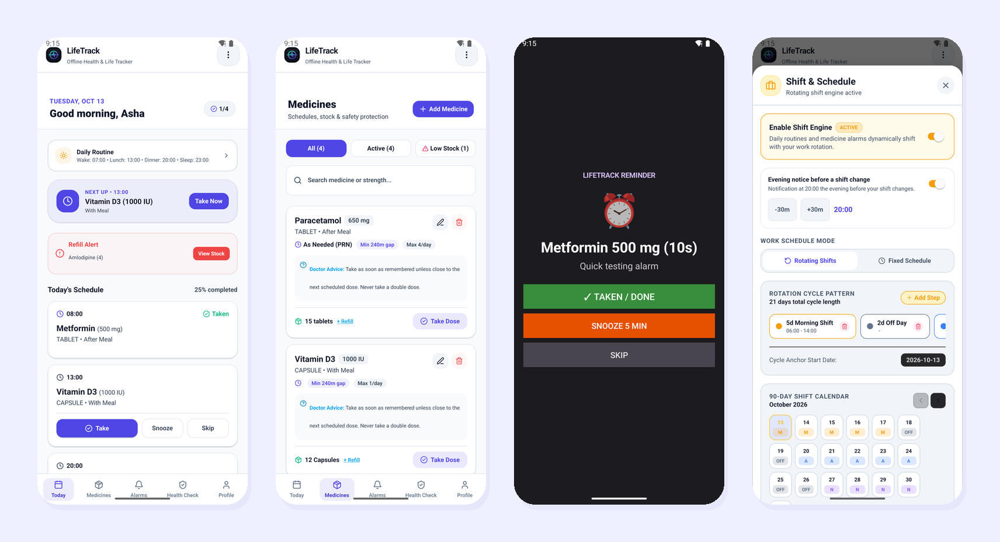
</p>

- **Alarms that ring.** Native Android `AlarmManager.setAlarmClock()` alarms fire on time in Doze mode, on a locked
  screen, and after the app is swiped away. They're restored after a reboot.
- **Medication safety.** Minimum gap between doses, a maximum-doses-per-day ceiling, stock tracking with low-stock
  alerts, and the doctor's "if I miss a dose" advice on every medicine.
- **Fits your day.** Doses can be fixed times, follow your routine ("with lunch", "30 min after waking"), or be
  as-needed (PRN). An optional rotating shift engine moves your routine with your work schedule.
- **Built for Indian households.** Available in English, हिन्दी (Hindi), मराठी (Marathi), and Español, with light
  and dark themes.

> **Contributors and coding agents:** start with [AGENTS.md](AGENTS.md). Current status, backlog, and roadmap live in
> [`docs/`](docs/README.md). [docs/STATUS.md](docs/STATUS.md) is the honest snapshot of what works today.

---

## 📥 Download & Install (Android)

<table>
  <tr>
    <td width="220" align="center">
      <br>
      <sub>Scan with your phone camera</sub>
    </td>
    <td>
      <b>Download the latest APK:</b><br>
      <a href="https://expo.dev/accounts/avinashdhumal1703/projects/lifetrack/builds/487e83de-8a37-4463-88a1-4e45b7b72a33">expo.dev → LifeTrack Android build</a>
      <br><br>
      Or copy and paste this link into your phone's browser:
      <pre>https://expo.dev/accounts/avinashdhumal1703/projects/lifetrack/builds/487e83de-8a37-4463-88a1-4e45b7b72a33</pre>
      <b>Requires:</b> Android 7.0 or newer. iPhone is not supported yet.
    </td>
  </tr>
</table>

### Install steps

1. Open the link (or scan the QR code) **on your Android phone** and tap **Install** / **Download** to get the `.apk`.
2. Open the downloaded file. If Android asks, allow your browser or file manager to **install unknown apps**
   (Settings → Apps → *your browser* → Install unknown apps → Allow).
3. If Google Play Protect shows *"Unsafe app blocked"* or *"App not scanned"*, tap **More details → Install anyway**.
   This appears for any app installed outside the Play Store.
4. Open **LifeTrack** and follow the 4-step setup.

**Updating:** install the newer APK over the old one. Your data is kept. Uninstalling the app deletes all its data,
so make a backup first (Profile → download icon).

### Allow these so reminders never miss

The first-run setup asks for these, and the **Health Check** tab shows what's still missing:

| Permission | Why |
| --- | --- |
| Notifications | Shows the reminder and its Taken / Snooze / Skip buttons. |
| Alarms & reminders (exact alarms) | Rings at the exact minute instead of "sometime soon". |
| Full-screen notifications (Android 14+) | Shows the alarm over the lock screen. |
| Battery: Unrestricted | Stops the phone from killing reminders in the background. Xiaomi, Samsung, OnePlus, Oppo, Vivo, and Realme phones also have an **Autostart** switch; Health Check links to it. |

---

## 🎬 Demo

<p align="center">
  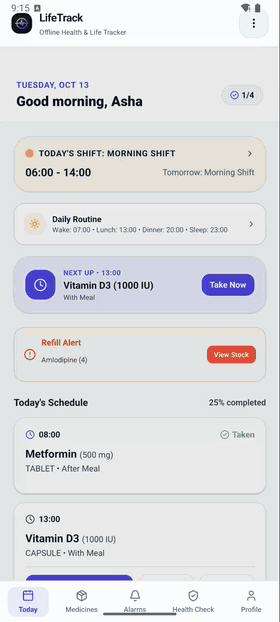
</p>

Full-quality video (2 min 20 s): [docs/media/lifetrack-demo.mp4](docs/media/lifetrack-demo.mp4). It shows Today →
Daily Routine → Medicines → adding a medicine → Shift & Schedule → Health Check → switching to Hindi → a test alarm
ringing on a locked phone.

---

## 📸 Screenshots

| Today | Medicines | Add / edit medicine |
| :---: | :---: | :---: |
| 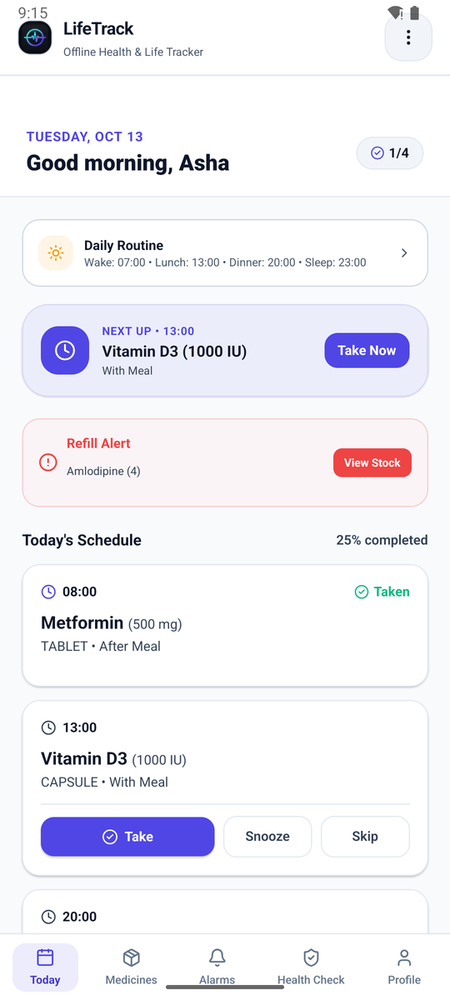 | 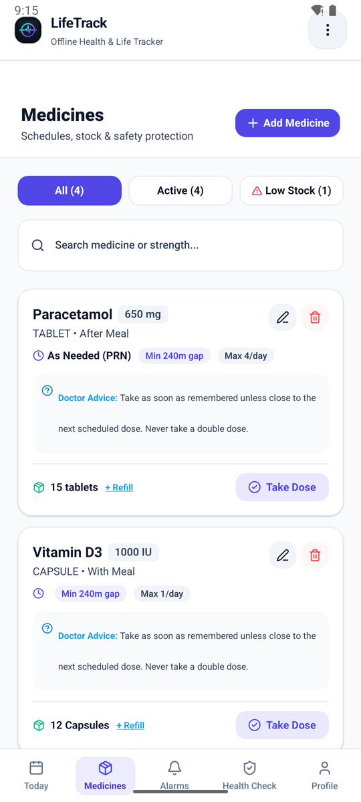 | 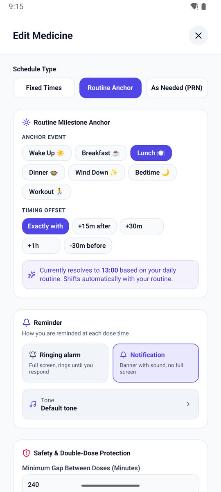 |
| **Alarm on the lock screen** | **Daily routine** | **Shift calendar** |
| 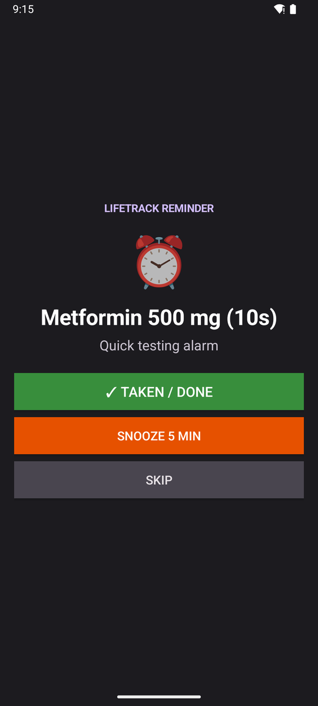 | 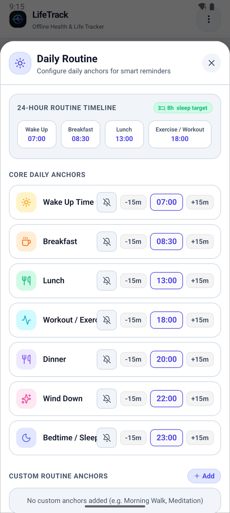 | 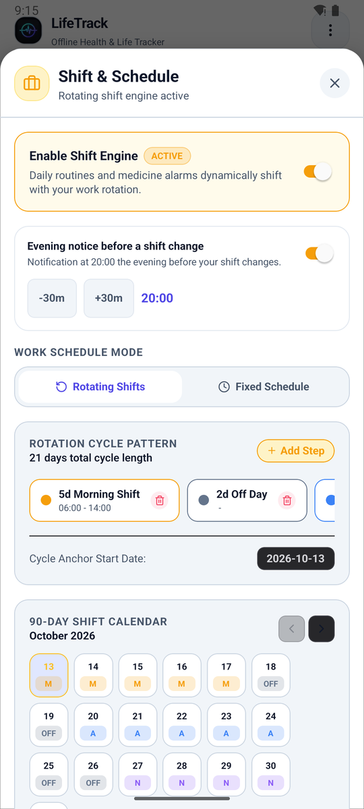 |
| **24-hour alarm timeline** | **Health Check** | **Profile & settings** |
| 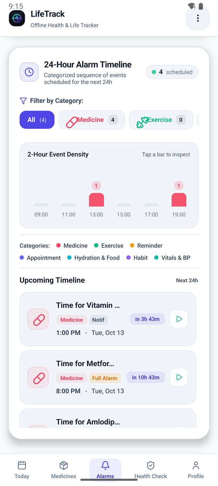 | 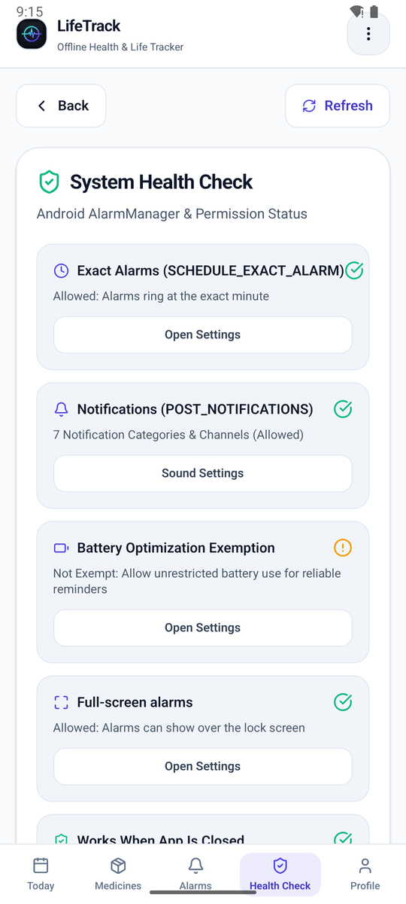 | 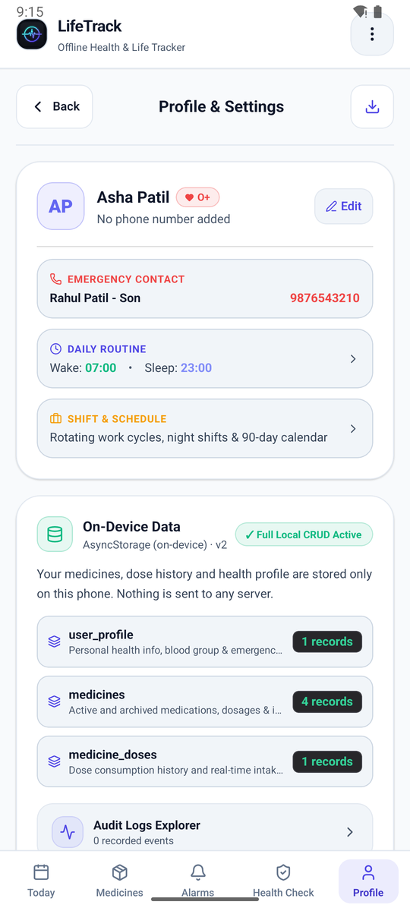 |

Screenshots use made-up demo data.

---

## 🧭 How to Use

1. **Set up (about 1 minute).** Read the privacy note, grant the reminder permissions, add your name, blood group, and an
   emergency contact (optional), and choose whether you work shifts.
2. **Add a medicine.** Medicines → **Add Medicine**. Enter the name and strength, form (tablet, syrup, …), and food
   instruction, then pick a schedule:
   - **Fixed Times**: e.g. 08:00 and 20:00.
   - **Routine Anchor**: e.g. "with lunch" or "+30 min after dinner". It moves when your routine changes.
   - **As Needed (PRN)**: no alarm; LifeTrack warns you if a dose is too soon or over the daily maximum.

   Choose **Ringing alarm** (full screen, rings until you respond) or **Notification** (a banner with sound), and
   optionally a tone. Set the current stock and when to warn you about a refill.
3. **When it rings,** tap **Taken**, **Snooze**, or **Skip**, on the lock screen, in the notification, or on the
   Today tab. Taken doses reduce the stock automatically.
4. **Today** shows every dose for the day, what's next, what's overdue, and low-stock warnings.
5. **Daily Routine** (⋮ menu or the Today card): set wake, meal, workout, and sleep times. Routine-anchored doses
   follow them. Each anchor can also have its own reminder bell.
6. **Shift & Schedule** (⋮ menu, optional): build a rotation such as "5 Morning, 2 Off, 5 Afternoon…", see a 90-day
   calendar, override single days, and get an evening notice before your shift changes.
7. **Health Check** tab: green ticks mean your phone is set up to ring reliably. Fix anything orange.
8. **Language and theme** (⋮ menu): English, Hindi, Marathi, or Spanish; light, dark, or system theme.
9. **Back up** your data (Profile → download icon) before you change phones or uninstall. Restore from the same screen.

> ⚠️ LifeTrack is a reminder and record-keeping tool. It is not medical advice and does not replace your doctor or
> pharmacist. Always follow your prescription.

---

## 🔒 Privacy

- No account, no sign-in, no server. The app makes **no network calls**.
- No analytics, crash reporters, or ads.
- All data lives in the app's private storage on your phone. Backups are files that you choose where to save or share.

See [ADR-0001](docs/decisions/0001-offline-first-no-cloud.md) for why.

---

## 🧑‍💻 Build From Source

LifeTrack is an [Expo](https://expo.dev) (SDK 57) / React Native 0.86 / TypeScript app with a custom Kotlin alarm
module in [`modules/alarm-engine/`](modules/alarm-engine/). Because of that native module it **does not run in Expo
Go**. Use the web preview for quick UI work and a development build on Android for real alarms.

### Prerequisites

- Node.js 20.19 or newer (22 LTS recommended), and npm
- For Android builds: JDK 17 and Android Studio (Android SDK + an emulator, or a phone with USB debugging)
- Optional, for cloud APK builds: a free [Expo account](https://expo.dev/signup) and `npx eas-cli`

### Run it

```bash
git clone https://github.com/avinaashdhumal/life-track.git
cd life-track
npm install
```

Quick UI check in the browser (uses an in-app alarm engine instead of the native one):

```bash
npm run web
```

On an Android emulator or a USB-connected phone (set `JAVA_HOME` and `ANDROID_HOME` first):

```bash
npx expo run:android
```

Checks to run before you open a pull request:

```bash
npm test && npm run lint
```

### Build an installable APK

With EAS (cloud, no Android Studio needed). The `preview` profile in [eas.json](eas.json) produces an `.apk`:

```bash
npx eas-cli login
```

```bash
npx eas-cli build -p android --profile preview
```

When it finishes, EAS prints a download link and QR code like the one above. You can also build locally; see
[Building a Release APK Locally](#-building-a-release-apk-locally).

---

## 🍴 Make Your Own Version

The code is MIT licensed (see [License](#-license)), so you can fork it and build your own app on top of it.

1. **Fork** the repository on GitHub and clone your fork.
2. **Rename the app** in [app.json](app.json): `name`, `slug`, `scheme`, `android.package`, and
   `ios.bundleIdentifier`. Use your own reverse-domain id, such as `com.yourname.meds`. Two apps with the same
   package name can't be installed side by side.
3. **Use your own Expo project:** delete `extra.eas.projectId` from `app.json`, then run `npx eas-cli init`.
4. **Replace the branding** in [`assets/`](assets/) (`icon.png`, `adaptive-icon.png`, `splash.png`, `favicon.png`).
5. **Add a language:** copy `src/i18n/locales/en.json` to e.g. `ta.json` and translate it. Then import it and add it
   to `SUPPORTED_LANGUAGES` and the language-code lists in [src/i18n/index.ts](src/i18n/index.ts), the
   `handleLanguageChange`/`handleSelectLanguage` types in `src/features/settings/`, and the `locales` lists in
   [test-i18n-theme.cjs](test-i18n-theme.cjs). `npm test` then checks every key exists in your file.
6. **Read the rules first:** [AGENTS.md](AGENTS.md) (golden rules) and [docs/ARCHITECTURE.md](docs/ARCHITECTURE.md).
   They explain how storage, migrations, and the alarm pipeline fit together, so a new feature doesn't break
   reminders or lose user data.

Ideas and the planned feature order are in [docs/ROADMAP.md](docs/ROADMAP.md) and [docs/BACKLOG.md](docs/BACKLOG.md).

---

## 🤝 Contributing

Bug reports, translations, and pull requests are welcome.

- **Found a bug?** Open an issue with your phone model, Android version, and what happened. Mention if a reminder
  didn't ring; those get top priority.
- **Pull requests:** pick an item from [docs/BACKLOG.md](docs/BACKLOG.md), follow
  [docs/CONVENTIONS.md](docs/CONVENTIONS.md), make sure `npm test` and `npm run lint` pass, and use
  [Conventional Commits](https://www.conventionalcommits.org/) that mention the backlog id, e.g.
  `fix(alarms): keep scheduleId on native sync (BUG-002)`.
- **Translations:** improvements to the Hindi, Marathi, and Spanish files in `src/i18n/locales/` are very welcome.

### Landing page

The website lives in [`site/`](site/) (plain HTML, CSS, and a little JS; fonts are self-hosted so the page has no
third-party requests). Screenshots and the demo video are reused from `docs/media/`. Preview it locally:

```bash
bash scripts/build-site.sh && python3 -m http.server 4173 -d _site
```

It's hosted free on **Cloudflare Pages** (project `lifetrack-app`), which builds from `main` on every push using
build command `bash scripts/build-site.sh` and output directory `_site`. No GitHub Actions are involved.

### Known limitations

- Android only for now. iOS is planned from the same codebase.
- The rewritten native alarm engine has been tested on the Android emulator (it rings over the lock screen). Testing
  on many real phones is still in progress ([DEBT-010](docs/BACKLOG.md)), so run the Health Check after installing.
- Some aggressive battery savers (on some Xiaomi, Oppo, Vivo, and Realme phones) can still delay alarms unless
  Autostart and Unrestricted battery are on.

---

## 📋 Feature Roadmap & Phase Status

The long-term plan. What works today is tracked honestly in [docs/STATUS.md](docs/STATUS.md).

| Phase | Feature Description | Status | Details |
| :--- | :--- | :---: | :--- |
| **Phase 0** | **Alarm Proof of Concept** | ✅ **Completed** | Native Kotlin module (`alarm-engine`), 7 notification channels, exact alarms, boot receivers, Doze bypass, full-screen lockscreen activity, test screen. |
| **Phase 1** | **Foundation, Medicines, Basic Today, Onboarding, Profile & Local DB** | ✅ **Completed** | Persistent local DB & storage engine, bottom navigation, dark/light theme, 4-language i18n (`en`, `hi`, `mr`, `es`), full onboarding flow, complete Medicine CRUD with safety rules & stock tracking, zero mock data. |
| **Phase 2** | **Daily Routine & Optional Shift/Schedule Engine** | 🟡 **In Progress** | Routine + rotating shift engine done; medicine reminders follow the routine. Shift-change evening notices work; per-shift dose times are still to do. See [docs/STATUS.md](docs/STATUS.md). |
| **Phase 3** | **Appointments, Treatments, Measurements, Symptoms & Sleep** | 📅 *Upcoming* | Doctor visits & reminders, treatment courses, vitals logging with target ranges & sparklines, symptom journal, sleep tracker. |
| **Phase 4** | **Conditions, Precautions & Food Guidance** | 📅 *Upcoming* | 15+ built-in conditions, Indian food lists (prefer/avoid), doctor instructions, avoid-flagging in meal logging. |
| **Phase 5** | **Fitness, Guided Session Player & Meditation Timer** | 📅 *Upcoming* | Workout library, yoga & pranayama, timestamp-based guided session player with Android foreground service, meditation timer. |
| **Phase 6** | **Nutrition (Simple & Detailed) & Water Tracker** | 📅 *Upcoming* | Simple (portion/photo) vs Detailed macro tracking, bundled 100 Indian foods database, daylight water tracker with reminders. |
| **Phase 7** | **Habits Engine** | 📅 *Upcoming* | Habits to build & reduce, streaks, monthly heatmaps, fixed and routine-relative habit reminders. |
| **Phase 8** | **Full Today Dashboard & Insights Tab (Analytics)** | 📅 *Upcoming* | Reorderable dashboard cards, timeline, pure domain adherence & vitals analytics, pattern observations, HTML/PDF Doctor Report. |
| **Phase 9** | **Backup & Restore, Security App Lock & Emergency Card** | 📅 *Upcoming* | Versioned JSON export/import, automatic SAF weekly backups, biometric/PIN app lock, emergency lockscreen card. |
| **Phase 10** | **Health Connect Import, Home Screen Widgets & Polish** | 📅 *Upcoming* | Read-only Android Health Connect sync, home screen widgets, performance tuning for 2+ years of data. |


---

## 🔍 Detailed Phase Status

<details>
<summary>Show what each phase covers</summary>

### ✅ Phase 0: Alarm Engine Proof of Concept (Completed)
- **Native Module (`modules/alarm-engine`)**:
  - Native Kotlin module using Android `AlarmManager.setAlarmClock()` and `setExactAndAllowWhileIdle()`.
  - Wakes device from deep Doze mode even when locked or app process is terminated.
  - Native `SharedPreferences` alarm persistence surviving process kills.
  - Native `BootReceiver` restoring alarms immediately upon `BOOT_COMPLETED`, `MY_PACKAGE_REPLACED`, `TIME_SET`, and `TIMEZONE_CHANGED` without waiting for JavaScript.
  - `AlarmFullScreenActivity` with `setShowWhenLocked(true)`, `setTurnScreenOn(true)`, and `FLAG_KEEP_SCREEN_ON`.
  - 7 Notification Channels: `medicines`, `appointments`, `routine`, `exercise`, `water_meals`, `habits`, `summaries`.
  - Native action buttons: `Taken / Done`, `Snooze (10m)`, `Skip`.
  - Manufacturer autostart & battery optimization intents (Xiaomi, Samsung, OnePlus, Oppo, Vivo, Realme).
- **Domain & Tests**:
  - Pure TypeScript domain functions in `src/domain/alarm.ts` and `src/domain/reminderPlanner.ts`.
  - Recurring rules: Daily, Weekly, Every N Days, Custom Dates, Monthly.
  - Standalone unit test suite (`npm test`).

### ✅ Phase 1: Foundation, Local Storage, Medicines & Onboarding (Completed)
- **Local Persistent Storage**:
  - `kvStore.ts`: the single AsyncStorage engine (in-memory fallback, sync cache for first render).
  - `StorageService.ts` (documents: settings, schedules, logs, routine, shifts) and `DatabaseService.ts` (tables: medicines, dose history, health profile), with one owner per piece of data.
  - Versioned migrations (`migrations.ts`) and a full, validated backup/restore (`DataManagementService.ts`).
  - Repositories in `src/data/` for clean domain interaction.
  - Clean state: Starts with **0 mock records**, **0 dummy medicines**, and empty initial profile.
- **Navigation & UI Shell**:
  - Bottom navigation bar: `Today`, `Medicines`, `Alarms`, `Health Check`, `Profile`.
  - Top header with unified quick-action menu (profile, routine, shifts, tones, language, theme, health check).
- **Internationalization & Accessibility**:
  - 4 Locales (`en`, `hi`, `mr`, `es`) with 100% key parity and automated checks (parity + every key used in code exists).
  - Full high-contrast Light and Dark theme palette.
  - Proper accessibility roles and labels on all interactive elements.
- **First-Launch Onboarding (`src/features/onboarding/OnboardingScreen.tsx`)**:
  - 4-step wizard: Privacy intro, Android reliability permissions, emergency health profile, optional work shifts decision.
- **Medicines Feature (`src/features/medicines/`)**:
  - Full CRUD operations: Add new medicine, Edit existing medicine, Delete medicine, Toggle active/paused.
  - Medicine metadata: Name, form (tablet, capsule, syrup, injection, drops, inhaler, other), strength, food relation, prescribing doctor, purpose, notes, color.
  - Stock tracking: Current units, auto-decrement on taken dose, refill reminder threshold, and low-stock badge.
  - Safety validation: Minimum dose gap interval check, max daily doses warning ceiling, custom missed dose instructions.
- **Today Tab (`src/features/today/TodayScreen.tsx`)**:
  - Live greeting, today's date, dose schedule progress bar.
  - Dose cards for today with one-tap "Take Dose" and "Skip" actions.
  - Clean empty state directing user to create their first medicine schedule.

---

### ⏳ Phase 2: Daily Routine & Optional Shift Engine (Next Phase)
- **Single Daily Routine (When Shifts are OFF - Default)**:
  - Configure single user wake time, sleep time, and meal times (breakfast, lunch, dinner).
  - Routine-relative reminder offsets (e.g. "30 minutes after wake up", "with breakfast", "1 hour before sleep").
- **Optional Shift and Schedule Engine (When user enables it)**:
  - On/Off toggle under `More > Shift and Schedule` (disabled by default).
  - Custom shift definitions: Morning (06:00-14:00), Afternoon (14:00-22:00), Night (22:00-06:00), General (09:00-18:00), Off day.
  - Shift rotation cycles (e.g. "5 Morning, 2 Off, 5 Afternoon, 2 Off, 5 Night, 2 Off" or weekly rotations).
  - Midnight-crossing night shift logic and manual date overrides (swaps, leave, overtime).
  - 90-day colour-coded shift calendar.
  - Per-shift daily routine templates and automatic reminder time adjustments.
  - Shift transition dose gap protection (preventing medicine doses from being scheduled closer than minimum gap during shift changes).
  - Shift eve notifications ("Tomorrow is Night shift. Your reminders have been adjusted.").

---

### 📅 Phase 3: Appointments, Treatments, Measurements, Symptoms & Sleep (Upcoming)
- **Appointments**: Doctor/clinic, speciality, date/time, questions to ask, follow-up reminders (1 day before, 2 hours before), visit outcome & report photos.
- **Treatments**: Treatment courses (physiotherapy, dressing changes, wound care), session logs.
- **Measurements & Vitals**: Blood pressure, blood sugar, weight, BMI, heart rate, SpO2, temperature, thyroid, with target ranges and sparklines.
- **Symptoms Journal**: Quick 1-10 severity logging with timestamps.
- **Sleep**: Bedtime, wake time, quality (1-5), planned vs actual duration, 7-day shortfall.

---

### 📅 Phase 4: Conditions, Precautions & Food Guidance (Upcoming)
- Built-in condition library (Diabetes, Hypertension, Thyroid, PCOS, Acidity, etc.).
- Offline bundled Indian food database with "Foods to Prefer" and "Foods to Limit/Avoid".
- User doctor's instructions priority over general guidance.
- Avoid-list food flagging during meal logging.

---

### 📅 Phase 5: Fitness, Guided Session Player & Meditation Timer (Upcoming)
- Exercise, yoga (Surya Namaskar, asanas), pranayama, and meditation library.
- Guided session player with audio/vibration cues and Android foreground service for screen-locked accuracy.
- Meditation timer with interval bells and breathing animations (4-7-8, box breathing).

---

### 📅 Phase 6: Nutrition & Water Tracker (Upcoming)
- Simple Mode (portion & photo) vs Detailed Mode (calories, macros, sodium).
- Offline 100 Indian foods dataset.
- Water tracker with quick-add sizes and interval reminders strictly during waking hours.

---

### 📅 Phase 7: Habits Engine (Upcoming)
- Habits to build & habits to reduce (days clean tracker).
- Yes/No, Count, and Duration types with streaks and monthly heatmaps.

---

### 📅 Phase 8: Full Today Dashboard & Insights Analytics (Upcoming)
- Reorderable dashboard cards, 24h timeline, attention cards.
- Pure domain adherence calculations, vitals moving averages, pattern observation correlation rules (>=14 days data).
- HTML/PDF Doctor Report generated via `expo-print` and `expo-sharing`.

---

### 📅 Phase 9: Backup & Restore, Security App Lock & Emergency Card (Upcoming)
- Single versioned JSON export/import with schema verification.
- Automatic weekly backups via Storage Access Framework.
- Biometric / PIN app lock with recent-apps screen privacy obscuring.
- Emergency lockscreen card.

---

### 📅 Phase 10: Health Connect Import, Android Widgets & Final Polish (Upcoming)
- Read-only Android Health Connect import (steps, sleep, heart rate, weight, BP, glucose).
- Android home screen widgets (Next medicine, Today progress, Water quick-add).
- Long-term database performance optimization for 2+ years of records.

</details>

---

## 🛠️ Testing & Verification

### Running Automated Test Suite
```bash
npm test && npm run lint
```
Runs:
1. `test-i18n-theme.cjs`: translation key parity across English, Hindi, Marathi, and Spanish; every `t('key')` used in the code exists; accessibility audit of every screen with interactive elements; theme tokens.
2. `scripts/run-tests.mjs`: every `src/**/__tests__/*.test.ts`, each run in two timezones (Asia/Kolkata and America/New_York) to catch date and daylight-saving bugs:
   - `alarm`, `alarmConflict`, `reminderPlanner`: recurrence rules, local-date occurrence ids, native roll-forward parity, DST.
   - `medicine`, `medicineReminders`: safety rules, stock, dose times (fixed / interval / routine), medicine reminder planning.
   - `shift`: rotation, overrides, midnight crossing, transition dose gaps.
   - `dataManagement`: storage migration, full backup round trip, legacy backup restore, invalid-file rejection.
3. `tsc --noEmit`: strict TypeScript typechecking.

Other checks:
```bash
npx expo export --platform android
```
Bundles the Android JavaScript (catches Metro errors without a JDK).
```bash
npm run web
```
Runs the app in a browser with the in-app alarm engine (no native module), for quick UI checks.

---

## 📱 Physical Android Phone Testing Guide

### Prerequisites
- Node.js (v18+)
- Android Studio with Android SDK (API 34/35) and platform tools (`adb`)
- A physical Android phone connected via USB with **USB Debugging** enabled

### 1. Install Dependencies
```bash
npm install
```

### 2. Generate Native Android Project (Expo CNG Prebuild)
```bash
npx expo prebuild -p android
```

### 3. Run Development Build on Physical Device
```bash
npx expo run:android --device
```

### 4. Running Reliability Tests

#### Test 1: Full Alarm 2 Minutes Ahead
1. Either add a medicine with a dose time 2 minutes from now (Medicines → Add Medicine), or open the **Alarms** tab and schedule a quick test alarm 2 minutes ahead.
2. Press the power button to **turn off the screen and lock the phone**.
3. Wait 2 minutes: The screen will turn on, show the full-screen alarm over the lock screen, ring, and vibrate.
4. Tap **Taken / Done** or **Snooze 10 Minutes**.

#### Test 2: App Swiped Away / Killed
1. Schedule a 2-minute alarm.
2. Open Android Recent Apps and **swipe LifeTrack away** to kill the app process.
3. Wait for the 2-minute mark: The alarm will fire directly from native Kotlin code via `AlarmReceiver`.

#### Test 3: Doze Mode Bypass
With the device connected to USB:
```bash
adb shell dumpsys battery unplug
adb shell dumpsys deviceidle force-idle
```
The alarm will still ring exactly on time because it uses `AlarmClockInfo`.
```bash
adb shell dumpsys battery reset
```

#### Test 4: Reboot Rescheduling
1. Schedule an alarm 10 minutes ahead.
2. Restart the phone:
```bash
adb reboot
```
3. Once booted up, inspect logcat to verify `BootReceiver` rescheduled all pending alarms:
```bash
adb logcat -s AlarmEngine:V LifeTrack:*
```

---

---

## 📦 Building a Release APK Locally
To build a release APK on your computer without a cloud service (needs JDK 17 and the Android SDK):
```bash
npx expo prebuild -p android
```
```bash
cd android && ./gradlew assembleRelease
```
The generated APK will be located at:
`android/app/build/outputs/apk/release/app-release.apk`

The Expo template signs this release build with the debug keystore, which is fine for installing on your own phones.
Before publishing to the Play Store, create your own upload key and signing config (see
[Expo: app signing](https://docs.expo.dev/app-signing/app-credentials/)), or let EAS manage the keys.

---

## 📄 License

[MIT](LICENSE) © 2026 Avinash Dhumal. You're free to use, change, and share this code, including in your own apps,
as long as you keep the copyright notice.
